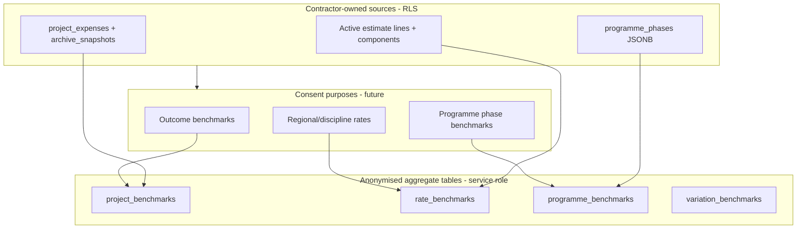

# A025 — Regional / discipline pricing and programme benchmarks (scope decision)

Date: 2026-11-15 · Base: `main` @ `33d8fd3f` · Branch: `cursor/a025-benchmark-scope-20261115` · Type: docs-only (no behaviour change)

## Outcome

This deliverable is a **decision-ready scope** for future cross-contractor benchmarks (estimate/pricing, programme duration, regional and trade-section cuts). It records an audit of the **existing single Industry Benchmarking checkbox**, evidence provenance, and a **synthetic fixture plan** for validation without activating live collection.

**Standing constraint (unchanged):** no new data collection, settings changes, SQL migrations, or deployment in this branch. A025 register status remains **Partial** until Rob approves scope and a separate implementation tranche is authorised.

---

## 1. Register intent (A025)

From `walkthrough-action-register.json` and walkthrough feedback (`docs/backup-snapshots/2026-10-18/walkthrough-import-privacy-feedback.json`):

| Theme | Future direction (not current product) |
| --- | --- |
| Regional unit pricing | e.g. driveway £/m² by UK region |
| Discipline / trade-section rates | Labour, plant, material medians by `trade_section` |
| Programme intelligence | Typical phase durations, delay distributions, on-time % |
| Estimate vs actual | Reconcile tendered lines with logged costs at archive |
| Commercial insight | Under/over-pricing signals, unrealistic durations — **advisory only**, not automated repricing |

Robert’s feedback: the **existing profile checkbox** must be **reconciled** with this broader vision — do not assume current copy, defaults, or implementation are adequate for unspecified secondary uses.

---

## 2. Current-state audit — “estimate / programme benchmark checkbox”

### 2.1 There is one consent control, not separate estimate vs programme toggles

| Surface | Control | Default | Persists to |
| --- | --- | --- | --- |
| Profile → section **Data consent** (`company-consent`) | `name="data_consent"` checkbox, `value="true"` | **Unchecked** (`profile?.data_consent ?? false`) | `profiles.data_consent`, `profiles.data_consent_at` |
| Estimating (`/dashboard/projects/costs`) | *None* | — | — |
| Programme (`/dashboard/projects/schedule`) | *None* | — | — |
| Cost library | *None* (separate “market benchmark” copy for system seed rates) | — | — |

**Implication:** “Estimate/programme benchmark checkbox” in the register means the **single archive-time consent** that gates whether **project-level outcomes** (margin, programme days, variations) may be copied into `project_benchmarks` on archive — not per-module opt-ins.

Evidence file: `a025-benchmark-audit-evidence.json`.

### 2.2 UI copy vs stored behaviour

Profile section **Industry Benchmarking** (`profile-form.tsx` ~834–857) claims:

- Only aggregated figures: margin %, project type, contract value band, programme duration.
- Withdrawal by unchecking; prior rows not removable.

**Server mapping** (`profile-update.ts` 44–45):

- Checked → `data_consent: true`, `data_consent_at: now()`.
- Unchecked / absent from POST → `data_consent: false`, `data_consent_at: null`.

**DB default** (`20260409100000_sprint42_benchmarks.sql` 8–9): `data_consent BOOLEAN DEFAULT false`.

### 2.3 What actually fires today (collection path)

| Step | Mechanism | Gated by consent? |
| --- | --- | --- |
| User archives project | `projects.is_archived` → `true` | — |
| Snapshot present | Latest `archive_snapshots` row for `project_id` | — |
| Benchmark insert | `fn_benchmark_on_archive()` (`20260930180000_harden_legacy_definer_functions.sql` 28–117) | **Yes** — reads `profiles.data_consent` |
| Target table | **`project_benchmarks` only** | — |
| `rate_benchmarks`, `programme_benchmarks`, `variation_benchmarks` | Tables exist; **no write triggers in migrations** | N/A |

Fields written on consent + archive (from snapshot + project):

- Financial: `gross_margin_pct`, `variation_count`, `variation_rate_pct`, `subcontract_cost_pct`
- Programme: `planned_duration_days`, `actual_duration_days`, `programme_delay_days`
- Classifiers: `project_type`, `contract_value_band` (from snapshot value bands), `region` ← **`NEW.site_address` (full string today — reidentification risk vs stated “band-only” copy)**

**Cohort launch profile:** `benchmark-api` and Business Intelligence route are **not** in the cohort capability set (`launch-profile.ts`); `/dashboard/intelligence` redirects home (`intelligence/page.tsx`). Contractors on cohort do not see BI nudge or external API regardless of consent.

### 2.4 Semantic collisions (must reconcile in a future copy/legal pass)

| User-facing term | Meaning today | Risk |
| --- | --- | --- |
| “Industry Benchmarking” checkbox | Opt-in to **archive trigger** → `project_benchmarks` | Copy does not mention estimate **line-level** or **rate** tables |
| Cost library “market benchmarks” | System **seed** rates in `mom_items` / overrides UI | Users may think checking the box shares library edits |
| Admin `/admin` Benchmarks tab | Reads `project_benchmarks` via service role | Internal only |
| `/api/v1/benchmarks` | `project_benchmarks` aggregate API | Disabled unless `full` profile + `benchmark-api` + API key |

Link to privacy workstream: **A023** (platform terms/consent evidence), **A024** (privacy copy — Complete). A025 scope assumes platform consent architecture may later split **purposes** (outcome vs line-rate vs programme-percentile) — not implemented here.

### 2.5 Audit gaps (documented, not fixed)

1. **Region field** stores raw `site_address`, not `projects.region` / postcode district band — conflicts with anonymisation narrative.
2. **Withdrawal** clears profile flag but does not stop rows already inserted (consistent with UI copy; needs legal sign-off).
3. **`data_consent_at` reset** on uncheck loses audit trail of when consent was first given (only “last true” timestamp behaviour).
4. **No estimate-line or programme-phase granularity** in live pipeline — tables `rate_benchmarks` / `programme_benchmarks` are schema-only placeholders vs CLAUDE.md Sprint 35 vision.

---

## 3. Target benchmark products (future — decision options)

### 3.1 Layer model (recommended)

**Decision D1 (default recommendation):** keep **one checkbox** for MVP+1 but **split purposes in copy and stored consent record** before enabling line-level collection (e.g. JSON purposes or separate booleans). Do **not** enable `rate_benchmarks` writes until purpose-specific consent is approved.

**Decision D2:** regional cuts use **`projects.region`** (or postcode-district derived), never full `site_address`, in aggregate tables.

**Decision D3:** discipline pricing uses existing **`trade_section`** + `estimate_line_components.component_type` normalisation; unit rates exported as **bands or percentiles**, not contractor sell rates tied to identifiable job sizes.

### 3.2 Programme benchmarks (future)

| Metric | Source fields | Aggregate shape |
| --- | --- | --- |
| Total job duration | `archive_snapshots.planned/actual_duration_days` | Already in `project_benchmarks`; roll up to `programme_benchmarks` by `project_type` + `contract_value_band` |
| Phase-level duration | `programme_phases[].manualDays/calculatedDays`, `startOffset` | Normalise phase names → `phase_name_normalised`; store P25/P50/P75 weeks |
| Delay drivers | Future: live delay log (Sprint 29) | `delay_cause` dimension in `programme_benchmarks` |

**Decision D4:** phase benchmarks require **minimum sample size** per cell (e.g. n ≥ 30) before surfacing to contractors or API.

### 3.3 Regional / discipline pricing (future)

| Metric | Source | Privacy control |
| --- | --- | --- |
| Labour day rate by trade + region | `estimate_line_components` (labour), `labour_rates` | Median / P25–P75; suppress cell if n < k |
| Material/plant unit rate | Components + `cost_library_items` match | Category-level, not supplier name |
| £/m² examples (driveways) | Normalised unit + quantity bands | Widen bands for sparse regions |

**Decision D5:** contractor-facing “you are X% above London median” (Sprint 43 vision) is **downstream** of A025 — requires consent + minimum N + UI separate from cost library seed rates.

---

## 4. Evidence provenance model (for implementation tranche)

Each aggregate row should be reconstructable in admin forensics **without** PII:

| Provenance field (proposed) | Purpose |
| --- | --- |
| `captured_at` | Already on benchmark tables |
| `source_event` | e.g. `archive`, `quarterly_rollup` |
| `source_schema_version` | Migration id / semver when shape changes |
| `contributor_cohort_hash` | Rotating salted hash of `user_id` — **not** stored in benchmark tables today; proposed for abuse detection only in admin metadata table |
| `lineage_run_id` | UUID for batch re-aggregation jobs |

**Synthetic vs live:** rows must carry `synthetic: true` flag (proposed column) in non-prod and in fixture SQL so admin/API never mix fixture data with production aggregates without explicit filter.

**Authoritative evidence chain for this scope doc:**

| Evidence type | Location |
| --- | --- |
| Code wiring audit | `a025-benchmark-audit-evidence.json` |
| Archive → benchmark smoke expectation | `scripts/verify-phase1-smoke.sql` 229–335 |
| Product intent | `walkthrough-import-privacy-feedback.json` `futureBenchmarking` |
| Schema | `supabase/migrations/20260409100000_sprint42_benchmarks.sql`, `20260930180000_harden_legacy_definer_functions.sql` |

---

## 5. Synthetic fixtures specification (no activation)

Goal: let CI/QA prove aggregation math and API shape **without** enabling contractor collection or writing to production benchmark tables.

### 5.1 Principles

1. Fixtures are **INSERT statements** run inside `ROLLBACK` transactions (mirror `verify-phase1-smoke.sql`).
2. All fixture projects use synthetic JWT user `10000000-0000-0000-0000-000000000001` pattern already used in phase-1 smoke.
3. Mark proposed `synthetic` column = true when column exists; until then, use dedicated `project_type = 'SYNTH_FIXTURE'` convention excluded from API defaults.
4. Never ship fixture inserts in app code paths — **scripts only**.

### 5.2 Minimum fixture matrix (recommended)

| Fixture ID | Exercises | Expected aggregate |
| --- | --- | --- |
| `FX-ARCH-CONSENT-ON` | `data_consent=true`, archive with snapshot | 1× `project_benchmarks` row, band `0-50k`, programme delay 2d |
| `FX-ARCH-CONSENT-OFF` | `data_consent=false`, same archive | **Zero** new benchmark rows |
| `FX-NO-SNAPSHOT` | Consent on, archive without snapshot | Zero rows (trigger early exit) |
| `FX-RATE-ROLLUP` (future) | Estimate with 3 labour lines, same trade/region | Upsert `rate_benchmarks` sample_size increment — **spec only until triggers exist** |
| `FX-PROG-PHASES` (future) | `programme_phases` with 4 normalised phases | Rows in `programme_benchmarks` — spec only |

### 5.3 Offline / hosted validation commands (read-only on this branch)

| Command | Pass criterion |
| --- | --- |
| `npx tsc --noEmit` | Zero errors |
| `npm test -- --runInBand src/app/dashboard/settings/profile/update-profile.test.ts src/lib/launch-profile.test.ts` | Consent mapping + cohort `benchmark-api` false |
| `rg -n 'data_consent|fn_benchmark_on_archive' supabase src` | Matches audit evidence inventory |

---

## 6. Reconciliation checklist (copy + product — for Rob / legal)

Before enabling any new collection beyond today’s archive outcome row:

- [ ] Align checkbox label with **actual tables written** (today: `project_benchmarks` only).
- [ ] Replace `region := site_address` in trigger with banded region logic (implementation tranche).
- [ ] Separate cost-library “seed benchmark” language from cross-contractor sharing in onboarding/tooltips.
- [ ] Tie checkbox to **A023** stored consent record if platform terms require versioned purposes.
- [ ] Confirm withdrawal / retention text with legal for UK GDPR lawful basis.
- [ ] Define minimum-N suppression rules before contractor-facing percentile UI (A026 customer insights).

---

## 7. Explicit non-goals (this branch)

- Changing `profile-form.tsx`, triggers, or API routes
- Applying migrations or toggling `data_consent` in hosted DBs
- Publishing benchmark API or re-enabling `/dashboard/intelligence`
- Updating register status to Complete

---

## 8. Validation performed (2026-11-15)

Recorded in commit message and `changelog.md` for this branch: TypeScript check and targeted Vitest for consent mapping; static audit captured in `a025-benchmark-audit-evidence.json`.